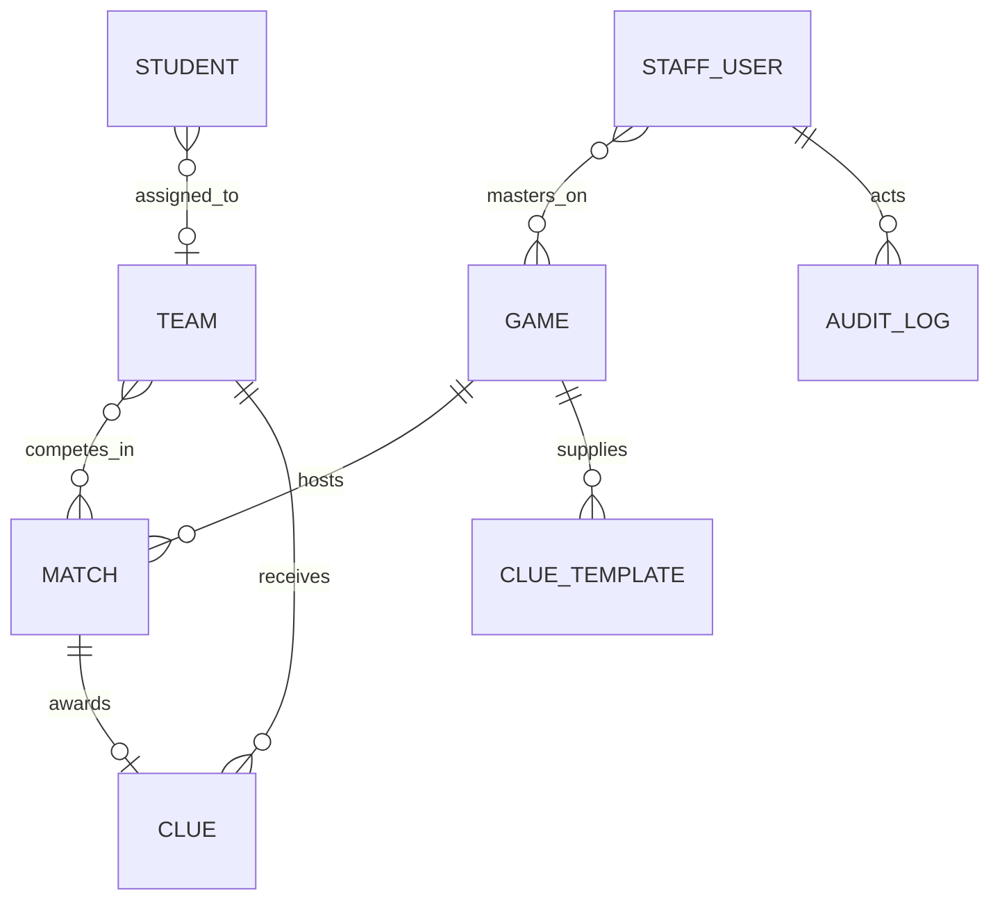

# YouPulse architecture: current state and target boundaries

## Current request flow

```mermaid
flowchart LR
  Public[Public browser] --> Home[app/page.tsx]
  Home --> Overview[GET /api/public/overview]
  Overview --> Models[Mongoose models]
  Staff[Staff browser] --> SignIn[Auth.js Credentials]
  SignIn --> StaffUser[(StaffUser)]
  Staff --> StaffPage[/staff]
  StaffPage --> Start[POST match start / server action]
  StaffPage --> End[POST match end]
  Start --> Permission[lib/permissions.ts]
  End --> Permission
  Permission --> Mongo[(MongoDB Atlas)]
  Admin[Admin browser] --> ParticipantUI[/staff/participants]
  ParticipantUI --> ParticipantAPI[/api/admin/participants]
  ParticipantUI --> TeamAPI[/api/admin/teams/*]
  ParticipantAPI --> Mongo
  TeamAPI --> Mongo
```

Current UI and route inventory is in [FEATURE_MATRIX.md](./FEATURE_MATRIX.md). Route handlers, rather than a separate backend, are the only API layer found. The `auth.ts` root module exports the Auth.js handlers/helpers; no middleware/proxy authorization layer was found.

## Current persistence model



The schemas are in [lib/models.ts](../lib/models.ts): `Student`, `Team`, `Game`, `Match`, `Rotation`, `RotationSlot`, `Clue`, `ClueTemplate`, `StaffUser`, `GameAssignment`, `EventSettings`, `BoardGame`, `BoardGameAssignment`, `SoloActivity`, `SoloParticipation`, and `AuditLog`. Game Master links are canonicalized in `GameAssignment`; the migration imports the old `Game.masters` and `StaffUser.assignedGames` arrays before removing them. See [DOMAIN_RULES.md](./DOMAIN_RULES.md) for the identity and migration contract.

## Existing boundaries

- **Database:** [lib/db.ts](../lib/db.ts) caches a Mongoose connection on `globalThis`. The URI is read at module load and missing URI fails when `connectDb` is called.
- **Auth:** [lib/auth.ts](../lib/auth.ts) uses Auth.js Credentials, bcrypt password comparison, JWT sessions, an eight-hour max age, and the configured `StaffUser.role` claim.
- **Authorization/domain operations:** [lib/permissions.ts](../lib/permissions.ts) contains `requireStaff`, per-match start and end operations, and the Game Master game-assignment check.
- **Admin endpoints:** participant read/import and team generate/lock routes call server-side role checks. Team generation uses a Mongo transaction; import and lock are not atomic with their audit writes.
- **Public projection:** the overview API aggregates clue counts but returns raw match documents, which should be narrowed before expanding the public contract.
- **Forms/data sync:** public page and participant list use SWR; the public page polls every five seconds. Other staff match data is server-rendered and not polled.

## Target architecture direction

Keep one Next.js project and preserve the existing collections. Add code in layers rather than adding more route-level Mongoose logic:

1. **Schemas and migrations:** the Phase 1 domain schemas, normalized indexes, migration and consistency check now exist. `EventSettings` stores event policy. Keep `Game` as a station and `Match` as a particular contest.
2. **Pure domain services:** separate team scoring, rotation planning, match transition validation, final-reveal readiness, and clue assignment from HTTP handling. Services accept a repository/session or transaction context and return typed results.
3. **Application services/repositories:** match transitions and participant/team writes use transactions, access checks, audit writes, idempotency, a team-in-match unique index, and active/frozen game checks. Broader workflows still need application APIs and MongoDB replica-set integration tests.
4. **Route handlers/server actions:** parse Zod inputs, authenticate/authorize, call a domain service, return narrow DTOs. Public endpoints use explicit allowlisted projections and pagination.
5. **Presentation:** reusable public, admin, and mobile GM shells; event data hooks have loading/error/retry handling. Avoid exposing internal IDs or sensitive data unless a specific use requires it.
6. **Verification:** pure unit tests for algorithms; Mongo replica-set integration tests for transactions/indexes/races; route tests for role visibility and clue confidentiality; Playwright workflows for staff/public operation.

## Data-model changes to plan (not implemented)

- **Event state/policy:** event lifecycle, active rotation games, approved team-size/remainder/bye rules, reveal state, and official winner.
- **Rotation assignment:** versioned schedule snapshots, station-aware rotation slots, validation/publication states, and transactional match creation now exist. Replica-set integration tests are still needed for publication races and migration rollback.
- **Game Master links:** choose one canonical assignment relationship and migrate references before removing the duplicate field.
- **Clue templates:** define whether each game has a clue pool or each match maps to one template; enforce sufficient unused content before event operation. Existing `used` boolean and match uniqueness do not express reservation/reveal state.
- **Team assignments:** protect historical match references while allowing only explicitly approved pre-event adjustments.
- **Audit:** immutable append-only operational record with required actor, action, target, snapshots, reason, and an append-only write policy. Existing Mongo middleware is not a database-level immutability boundary.

No schema migration should be run against production until the source database has been backed up and current documents/indexes have been inspected.

